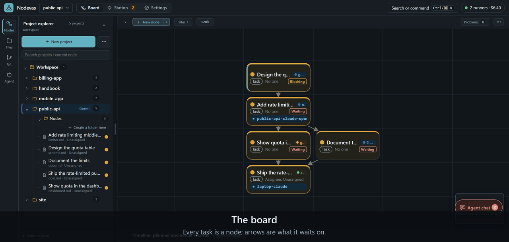
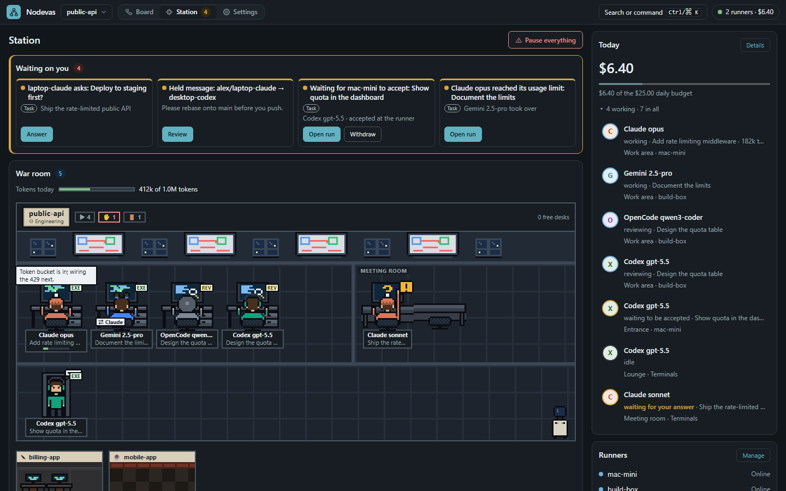
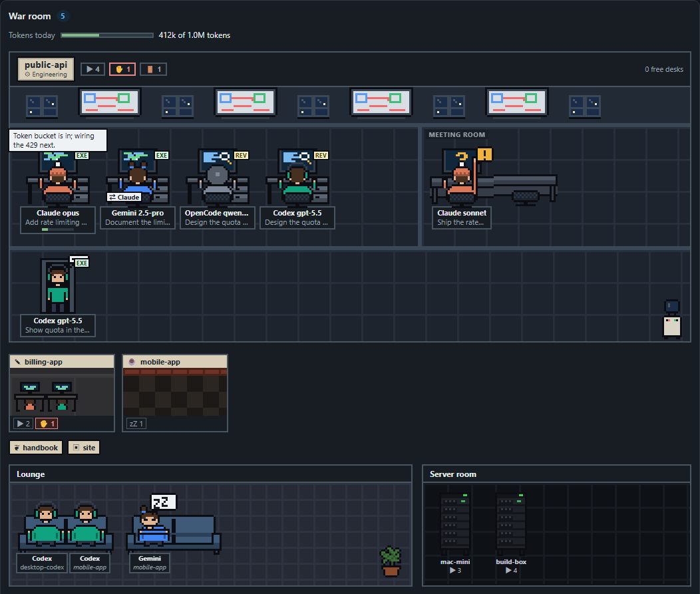

# Nodevas

[繁體中文](./README.zh-TW.md)

> A visual workspace for your notes, tasks, and AI agents.

Put your work on a canvas as nodes, connect them, and see what is ready to start. When a task is ready, hand it to a coding agent on your own machine and get a pull request back.



## What you can do

- **Plan visually.** Each node is a Markdown page with a type, status, assignee, priority, and tags. View them on a dependency graph and a timeline.
- **Model dependencies.** Link nodes with conditions like `AND` or `OR`; Nodevas shows which work is ready.
- **Hand work to agents.** Send a node to Claude Code, Codex, Gemini CLI, OpenCode, or Antigravity CLI. Watch it run live, review the diff, merge the PR.
  <!-- sec-pass: permission relay -->
- **Answer your agents.** Agents can ask for your approval, ask you a question, or offer a choice; a runner can also relay their CLI's permission prompts once you turn that on. Answer in Agent chat or Station.
- **Connect any MCP client.** Agents can find ready tasks, claim them, and report back.

## Board, Station and Settings

Every project has three faces, switched in the top bar:

- **Board** is where you plan: graph, timeline, pages and dependencies.
- **Station** is where your agents work together: what waits on you (questions, permission prompts, reviews, PRs to merge or fix, usage limits, the daily budget), the live war room, who is working on what, who did what in the last hour, today's spend, your runners, and Agent chat. Autopilot drives a goal's tasks from here, and **Pause everything** pauses your autopilots and cancels your runs that have not started.
- **Settings** has a search box and four sections: **General** (appearance, language, text size, notifications, voice copilot), **Agents** (runners, and under Advanced the daily budget, routing rules, roles, workflow stages, usage details and agent performance), **This project** (lifecycle, node types, office style, milestone types, people, backup and history), and **Account** (on a team server, your account and two-factor sign-in, plus server accounts and the audit log for administrators).





Every agent, item, office, and rack in the war room is a button: an agent's menu opens its run, changes, node or goal, pauses its autopilot, or cancels the run. When an agent asks you something or wants to run a tool, hits its usage limit, or the budget runs out, the browser tells you.

## Quick start

**Standalone, on one machine.** No account, mail, or two-factor sign-in. Needs Go 1.26.10, Node.js 22, and Git:

```bash
git clone https://github.com/staphit/Nodevas.git && cd Nodevas
npm ci --prefix web && npm run build --prefix web && go build -o nodevas ./cmd/nodevas
./nodevas serve --project ./workspace
```

Open <http://127.0.0.1:5666>. The same command starts a runner for coding agents; add `--repo ~/code/my-app` to let runs work in a repository, or `--no-runner` to leave it out. More, including Docker on Linux: [Standalone](./docs/getting-started.md#standalone).

**Team server.** Run the hub with Docker (`ghcr.io/staphit/nodevas`) on a server or NAS behind HTTPS, with an admin account (`nodevas user add`) and an SMTP relay for sign-in passcodes; people open it in a browser. Each person can add a runner on their PC with `scripts/install.sh --hub <url> --link`, which downloads a GitHub-verified build, or builds from a checkout with Go 1.26 or newer ([details](./docs/install.md)). Steps: [Team server](./docs/getting-started.md#team-server).

## Run agents on your machine

https://github.com/user-attachments/assets/8e494381-8aeb-4c58-9cf8-251f4c0f3060

<!-- sec-pass: runner trust -->
The server shows the board; a small **runner** on your PC runs the agents with your own logins, in your own repositories. Setup, security, autopilot, and more demos: [Agent workstation](./docs/workstation.md).

The agent controls are hidden at first. They appear when you turn on **Settings → Agents → Let agents work here** or open Station, and by themselves once the workspace has a runner, a run, or a connected agent.

## Learn more

- [Concepts](./docs/concepts.md) · [Timeline](./docs/timeline.md) · [MCP](./docs/mcp.md) · [Voice copilot](./COPILOT.md) · [Token usage](./docs/usage.md)
- [Install a runner](./docs/install.md) · [Operations](./docs/operations.md) · [History and backup](./docs/history-and-backup.md) · [Team server and co-editing](./docs/collaboration.md)
- Examples: [AI harness](./demo/ai-harness-engineering) · [Daily schedule](./demo/daily-work-schedule) · [Novel writing](./demo/novel-writing)
- [Contributing](./docs/contributing.md) · [Code signing policy](./docs/code-signing-policy.md)

The agent workstation, MCP, co-editing, backup, and version history are in beta and may change.

## License

[GPL-3.0](./LICENSE)
