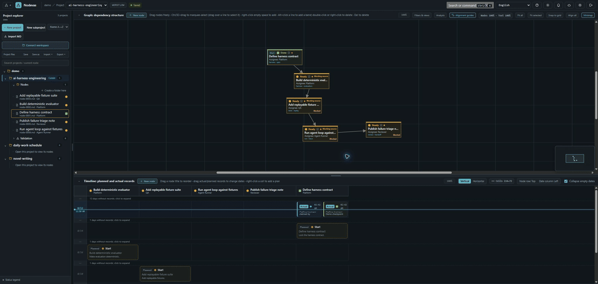
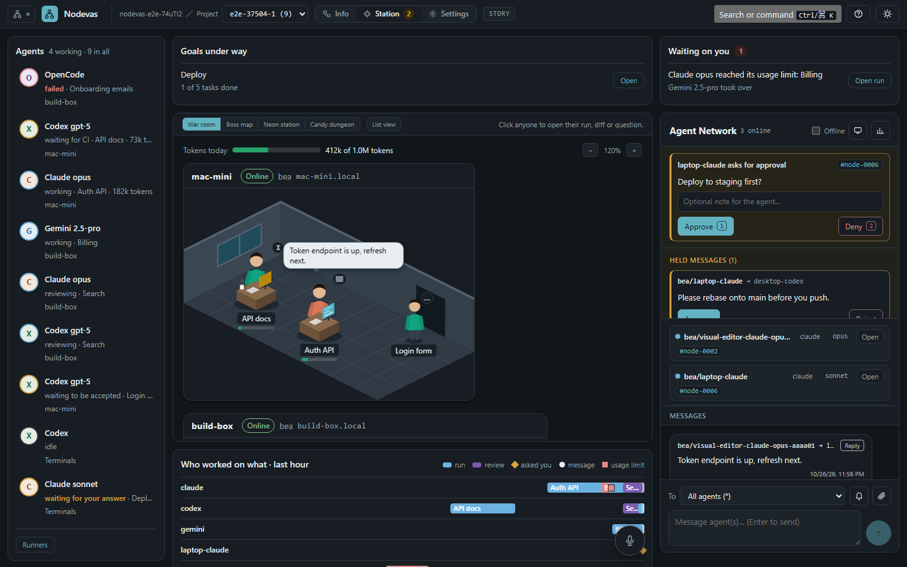
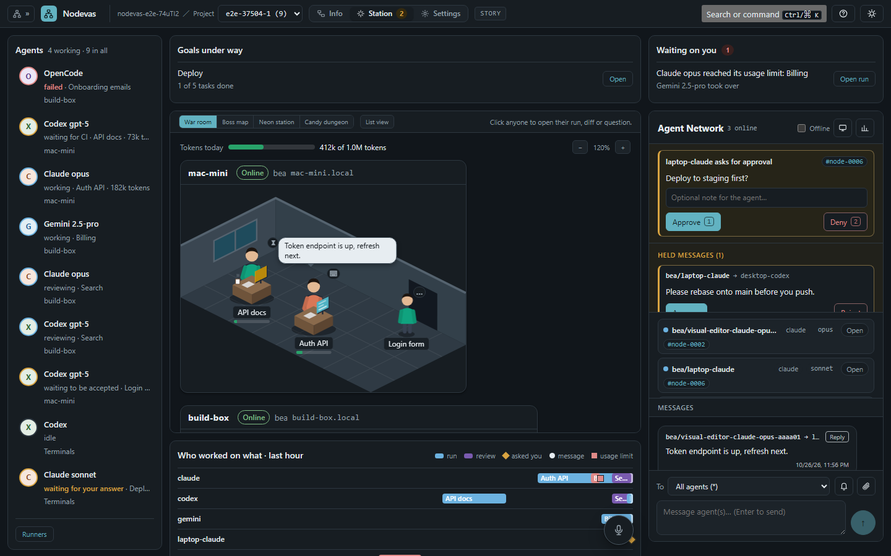
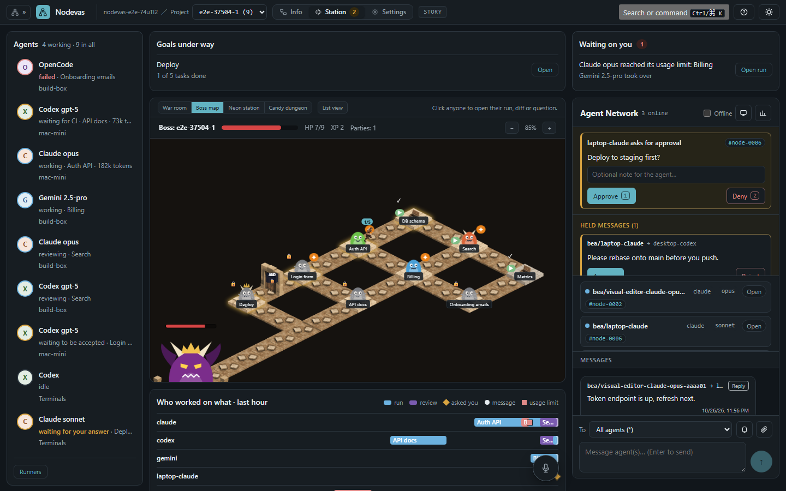
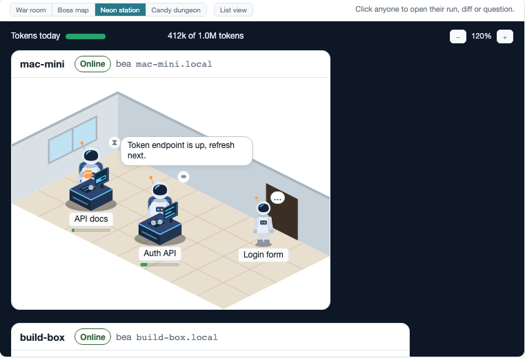
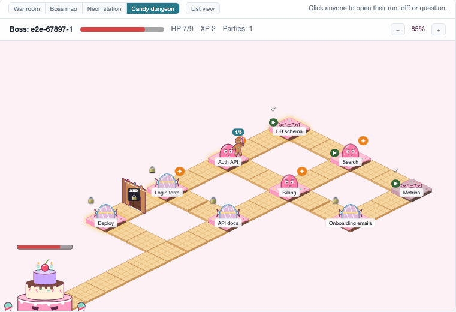

# Nodevas

[繁體中文](./README.zh-TW.md)

> A visual workspace for your notes, tasks, and AI agents.

Put your work on a canvas as nodes, connect them, and see what is ready to start. When a task is ready, hand it to a coding agent on your own machine and get a pull request back.



## What you can do

- **Plan visually.** Each node is a Markdown page with status, assignee, priority, and tags. View them as a graph, board, or timeline.
- **Model dependencies.** Link nodes with conditions like `AND` or `OR`; Nodevas shows which work is ready.
- **Hand work to agents.** Send a node to Claude Code, Codex, Gemini CLI, OpenCode, or Antigravity CLI. Watch it run live, review the diff, merge the PR.
- **Connect any MCP client.** Agents can find ready tasks, claim them, and report back.

## Info, Station and Settings

Every project has three faces, switched in the top bar:

- **Info** is the board: graph, timeline, pages and dependencies, where you plan.
- **Station** is where your agents work together. You see who is working on what, the live war room or boss map, a timeline of who did what in the last hour, what waits on you (questions, merges, usage limits, the daily budget), and what the agents say to each other. Autopilot drives a goal's tasks from here.
- **Settings** is one page for the rest: the project's statuses, milestones and people, notifications, backup and history, your appearance and language, the voice copilot, the agent workstation (runners, usage, daily budget, routing rules), and on a team server your account and two-factor sign-in, plus server accounts and the audit log for administrators.



| War room: each runner is an office, each agent at a desk | Boss map: the project is a boss; finishing nodes takes its HP down |
| --- | --- |
|  |  |

Every character and monster opens the real node, run, diff, or PR. When an agent asks you something, hits its usage limit, or the budget runs out, the browser tells you.

**Make it yours.** A [view pack](./docs/view-packs.md) restyles the war room or the boss map with your own pictures. It is a zip of `pack.json` and images, with no code; an admin installs it for everyone. Two examples are in [`examples/view-packs`](./examples/view-packs):

| Neon station (war room) | Candy dungeon (boss map) |
| --- | --- |
|  |  |

## Quick start

**Standalone, on one machine.** No account, mail, or two-factor sign-in. Needs Go 1.26.10, Node.js 22, and Git:

```bash
git clone https://github.com/staphit/Nodevas.git && cd Nodevas
npm ci --prefix web && npm run build --prefix web && go build -o nodevas ./cmd/nodevas
./nodevas serve --project ./workspace
```

Open <http://127.0.0.1:5666>. The same command starts a runner for coding agents; add `--repo ~/code/my-app` to let runs work in a repository, or `--no-runner` to leave it out. More, including Docker on Linux: [Standalone](./docs/getting-started.md#standalone).

**Team server.** Run the hub with Docker (`ghcr.io/staphit/nodevas`) on a server or NAS behind HTTPS, with an admin account (`nodevas user add`) and an SMTP relay for sign-in passcodes; people open it in a browser. Each person can add a runner on their PC with `scripts/install.sh --hub <url> --link`, which downloads a GitHub-verified build, or builds from a checkout with Go 1.26 or newer ([details](./docs/install.md)). Steps: [Team server](./docs/getting-started.md#team-server).

## Run agents on your machine

[](./docs/videos/agent-run.mp4)

The server shows the board; a small **runner** on your PC runs the agents with your own logins, so your code never leaves your machine. Setup, security, autopilot, and more demos: [Agent workstation](./docs/workstation.md).

## Learn more

- [Concepts](./docs/concepts.md) · [Timeline](./docs/timeline.md) · [MCP](./docs/mcp.md) · [Voice copilot](./COPILOT.md) · [Token usage](./docs/usage.md)
- [Install a runner](./docs/install.md) · [Operations](./docs/operations.md) · [History and backup](./docs/history-and-backup.md) · [Team server and co-editing](./docs/collaboration.md)
- Examples: [AI harness](./demo/ai-harness-engineering) · [Daily schedule](./demo/daily-work-schedule) · [Novel writing](./demo/novel-writing)
- [Contributing](./docs/contributing.md) · [Code signing policy](./docs/code-signing-policy.md)

The agent workstation, MCP, co-editing, backup, and version history are in beta and may change.

## License

[GPL-3.0](./LICENSE)
