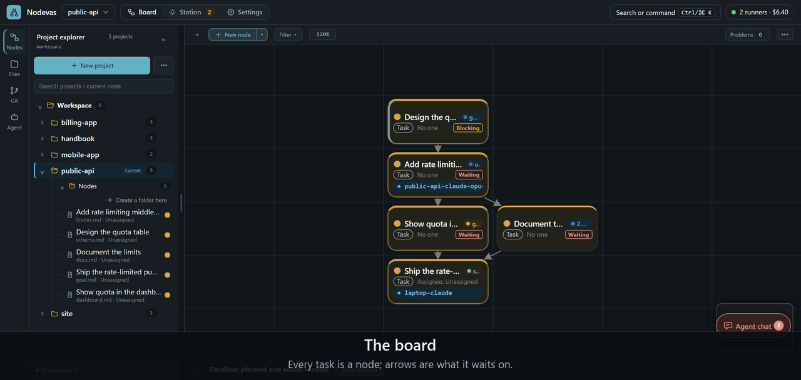
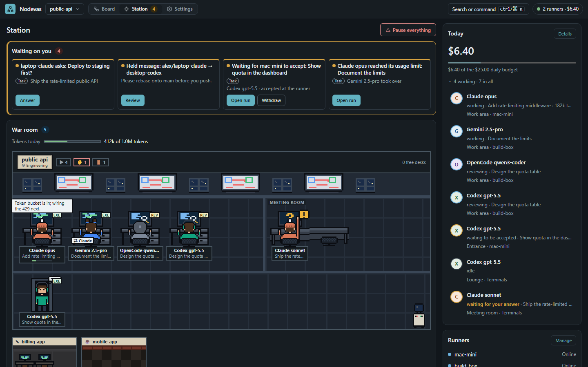
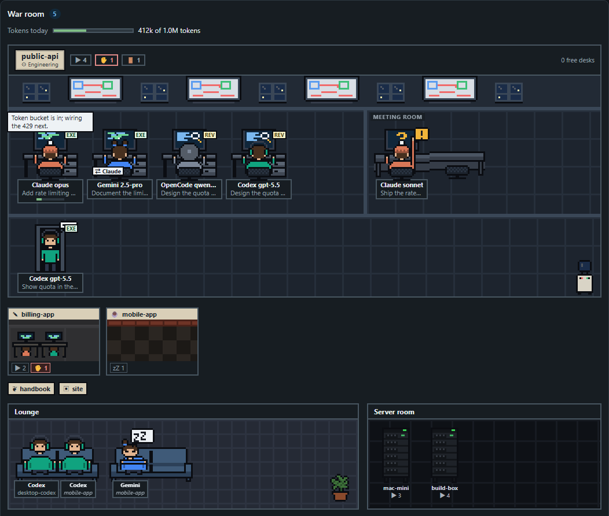

# Nodevas

[English](./README.md)

> 放筆記、任務與 AI agent 的視覺化工作區。

把工作變成畫布上的節點，連起來，就能看出哪些事現在可以開始。任務準備好了，就交給你自己電腦上的 coding agent，做完以 pull request 回來。



## 可以做什麼

- **視覺化規劃**：每個節點是一頁 Markdown，帶有類型、狀態、負責人、優先度與標籤。可在相依關係圖與時間軸上檢視。
- **管理依賴**：用 `AND`、`OR` 等條件連接節點，Nodevas 會告訴你哪些工作可以開始。
- **把工作交給 agent**：把節點派給 Claude Code、Codex、Gemini CLI、OpenCode 或 Antigravity CLI，即時看它工作、看 diff、合併 PR。
- **回覆你的 agent**：agent 可以請你核准、問你問題或請你選擇；你替 runner 開啟轉發後，它也會把 Claude Code、Antigravity CLI 與 OpenCode（ACP）的權限請求轉給你（預設關閉，見[安全模型](#安全模型)）。在 Agent 對話或工作站回覆。
- **接上任何 MCP client**：agent 可以找出可做的任務、認領，並回報進度。

## 看板、工作站與設定

每個專案有三種檢視，在頂列切換：

- **看板**：規劃的地方，包括圖、時間軸、頁面與相依關係。
- **工作站**：你的 agent 一起工作的地方，包括等你處理的事（提問、權限請求、審查、待合併或待修正的 PR、用量上限、每日預算）、即時的戰情室、誰在做什麼、過去一小時誰做了什麼、今天的花費、你的 runner 與 Agent 對話。自動推進從這裡推動一個目標的任務；**全部暫停**會暫停你的自動推進，並取消你尚未開始的執行。
- **設定**：上方有搜尋框，下分四個區塊：**一般**（外觀、語言、文字大小、通知、語音 Copilot）、**Agent 與 Runner**（runner，以及進階裡的每日預算、路由規則、角色、工作流程階段、用量明細與 Agent 表現）、**這個專案**（實際狀態、節點類型、辦公室風格、里程碑類型、成員、備份與歷史）與**帳號**（團隊 server 上你的帳號與兩步驟驗證，管理員另有伺服器帳號與稽核紀錄）。





戰情室裡的每個 agent、物品、辦公室與機櫃都是按鈕：agent 的選單可開啟它的執行、變更、節點或目標，暫停它的自動推進，或取消這次執行。agent 問你問題或想執行工具、用量達上限，或每日預算用完時，瀏覽器會通知你。

## 快速開始

**單機版**：不需要帳號、郵件或兩步驟驗證。需要 Go 1.26.10、Node.js 22 與 Git：

```bash
git clone https://github.com/staphit/Nodevas.git && cd Nodevas
npm ci --prefix web && npm run build --prefix web && go build -o nodevas ./cmd/nodevas
mkdir -p workspace && ./nodevas serve --project ./workspace
```

開啟 <http://127.0.0.1:5666>。第一次啟動會下載一次固定版本的 PostgreSQL（約 40–93 MB）；按兩次 Ctrl+C 即可停止。同一個指令也會啟動執行 coding agent 的 runner；加上 `--repo ~/code/my-app` 讓 run 能在該 repo 工作，或用 `--no-runner` 不啟動它。更多內容（含 Linux 上的 Docker）：[Standalone](./docs/getting-started.md#standalone)（英文）。

**團隊 server**：在 server 或 NAS 上用 Docker（`ghcr.io/staphit/nodevas`）執行 hub，經 HTTPS 對外，並設定管理員帳號（`nodevas user add`）與寄送登入驗證碼的 SMTP relay；大家用瀏覽器開啟。每個人可在自己電腦上用 `scripts/install.sh --hub <url> --link` 加裝 runner，它會下載經 GitHub 驗證的執行檔，或在有 Go 1.26 以上的 checkout 裡從原始碼建置（[細節](./docs/install.md)，英文）。步驟：[Team server](./docs/getting-started.md#team-server)（英文）。

## 在自己電腦上跑 agent

https://github.com/user-attachments/assets/ab98a136-677c-473e-9f94-45a330ec74e6

server 只負責顯示看板；你電腦上的小程式 **runner** 用你自己的登入，在你自己的 repo 裡執行 agent，而且只執行你同意的 run。設定、安全、自動推進與更多示範影片：[Agent 工作站](./docs/workstation.zh-TW.md)。

agent 相關功能一開始是隱藏的。開啟 **設定 → Agent 與 Runner → 讓 agent 在這裡工作** 或進入工作站時就會出現；工作區一有 runner、執行紀錄或已連線的 agent，也會自動出現。

## 安全模型

- **單機版與桌面版信任這台電腦。** 單機 hub（loopback、沒有 proxy、TLS 或 Access）沒有帳號，所以這台電腦上任何程式（不論哪個使用者）都能連到它，並以你的身分操作。請在只有你一個人使用的電腦上使用。用每次啟動的 token 封住這點是未來可能的改動；需要的話請開 issue。
- **團隊 hub** 需要帳號、HTTPS 與郵件。決定它信任誰的設定（公開主機名稱、proxy、TLS、Cloudflare Access、Copilot bypass、不在本機的 Copilot 或 SMTP 伺服器）只能來自 `--config`／`NODEVAS_CONFIG`、環境變數或指令列參數，不能寫在工作區自己的 `nodevas.yaml` 裡；見 [Operations](./docs/operations.md#configuration)（英文）。
- **runner 執行 hub 送來的工作，但只在它自己的限制內。** 每個 run 都要你在它的終端機上同意，唯讀的 run 保持唯讀，能執行任意 shell 指令的 agent 一律留給人決定。自動接受預設關閉：請保持關閉，或只用在你願意讓任何掌控 hub 的人執行的 repo 與 agent 上。
- **權限轉送是一種取捨。** 打開 `permissionRelay` 後，你按的**允許**會經由 hub 送到 runner，所以被入侵的 hub 可以偽造一個允許。它永遠不會放寬唯讀 run 或 CLI 自己的拒絕規則。它預設關閉；除非你信任這個 hub，否則請保持關閉。
- **已知限制。** 知道某位成員登入信箱的人，可以靠輸入錯誤的驗證碼，讓那位成員每次有幾分鐘無法登入。在 proxy 後面時，如果 `trusted_proxy` 沒涵蓋那個 proxy，hub 會把 HTTPS 請求當成一般 HTTP：cookie 少了 `Secure`，也不會送出 HSTS。經由本機上不加轉送標頭的 proxy 或通道（純 TCP 通道、預設標頭的 nginx）連到單機版 hub 或 dev server 的人，會被當成你。

## 延伸閱讀

- [核心概念](./docs/concepts.md) · [時間軸](./docs/timeline.md) · [MCP](./docs/mcp.md) · [語音 Copilot](./COPILOT.md) · [Token 用量](./docs/usage.md) · [主題包](./docs/theme-packs.zh-TW.md)
- [安裝 runner](./docs/install.md) · [維運](./docs/operations.md) · [版本歷史與備份](./docs/history-and-backup.zh-TW.md) · [團隊 server 與共編](./docs/collaboration.md)
- 範例：[AI harness](./demo/zh-TW/ai-harness-engineering) · [日常排程](./demo/zh-TW/daily-work-schedule) · [小說撰寫](./demo/zh-TW/novel-writing)
- [協助開發](./docs/contributing.md) · [程式碼簽章政策](./docs/code-signing-policy.md)

Agent 工作站、MCP、即時共編、備份與歷史紀錄目前為 Beta，之後可能調整。

## 授權

[GPL-3.0](./LICENSE)
