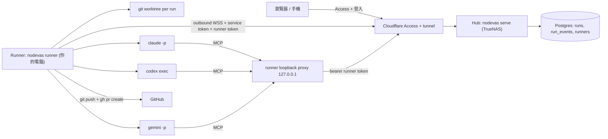

# Nodevas 個人工作站計畫

目標：Nodevas 成為個人工作站。Board 是指揮中心，node 是任務；從網頁（`nodevas.cola-stone.com`，網址 + 登入即可）派工給 Claude Code / Codex / Gemini 等不同 agent 與模型，看即時進度，agent 改完程式碼自動開 PR，結果回到 node 上。

建立在 PR #10 的 agent network（roster、訊息、`ask_user`、hooks、`setup-agent`）之上。

## 已定決策（2026-10-23）

| 項目 | 決定 |
| --- | --- |
| 部署 | 沿用 TrueNAS + Cloudflare tunnel，使用者只需網址 + 登入 |
| 遠端能力 | 第一版只看 + 核准；架構保留遠端派工，之後以開關開啟 |
| 改動處理 | 每次 run 一個 worktree + branch，完成後**自動開 PR** |
| 模型 | 多 agent CLI、多模型並存，每次 run 可選，可設路由規則 |
| Agent 間溝通 | Nodevas 內建 network（經 Hub）；[reason-network](https://github.com/reason-machines/reason-network) 只作為設計參考，不用它的網路和帳號 |
| 對外存取 | 這版上線後，`nodevas.cola-stone.com` 前面加 Cloudflare Zero Trust（Access） |

## 架構：Hub + Runner



**原則：Hub 永遠不執行程式。** NAS 上的 server 只排程、存紀錄、推 UI。程式碼、CLI 登入憑證、`gh` token 都留在 runner 機器上。

**Runner 是信任邊界。**
- `nodevas runner` 是跑在你電腦上的 daemon，只做對外連線（outbound），不開任何對外 port。
- 它自己決定能不能接某個工作：repo 必須在 allowlist 裡，派工政策也要允許。
- 之後要開放「遠端派工」，只要在 runner 端打開 auto-accept，再加上 step-up 驗證。

**MCP 接法。** 現行 shared 部署會忽略 `X-Nodevas-Agent-Role`，`nodevas mcp` 也只肯連 loopback（`internal/auth/session.go`）。所以：
- runner 在 `127.0.0.1:<port>` 開一個 proxy，run 裡的 `nodevas mcp --server http://127.0.0.1:<port>` 連這個 proxy；
- proxy 加上 `Authorization: Bearer <runner token>` 後轉送到 Hub；
- Hub 新增 `RunnerTokenAuth`：只接受 runner token，actor 為 token 擁有者，agent class 限 worker/orchestrator，而且只能存取 agent / MCP 需要的路由。

### 兩種執行模式（參考 Orca）

[stablyai/orca](https://github.com/stablyai/orca) 的做法：每個 agent 在自己的 worktree 裡，以**互動式 TUI 跑在 PTY 中**（node-pty + xterm.js），使用者自備訂閱。狀態有兩個來源：

- agent 的 hooks 會 POST 到本機的 hook server；
- 沒有 hook 時，改從 PTY 輸出解析 OSC 7501（Program Status Protocol）作為後備。

遠端則由 `orcad` daemon 負責，跑在 SSH remote worktree 上。

Nodevas runner 兩種模式都支援：

| 模式 | 指令 | 用途 | 狀態來源 |
| --- | --- | --- | --- |
| `headless`（W1 起） | `claude -p --output-format stream-json` 等 | 自動派工 → PR，手機也能看 | stream 事件 + nodevas hooks |
| `interactive`（W2.5） | 互動式 `claude` / `codex` / `gemini` 跑在 runner PTY 中，經 WSS 轉到網頁上的 xterm.js | 想中途介入、在 TUI 裡核准、和 agent 對話 | nodevas hooks（已有）+ OSC 7501 後備解析 |

兩種模式共用 worktree、branch、PR 流程與 run 紀錄；只有 adapter 的啟動方式和事件來源不同。

## Agent 間溝通：Nodevas 內建 network（借鑑 reason-network 的設計）

**決定（2026-10-23）**：[reason-network](https://github.com/reason-machines/reason-network) 只作為設計參考，**不使用**它的 P2P 網路、relay 和 Reason 帳號，避免把信任交給第三方。agent 之間的溝通沿用 PR #10 的內建 network：訊息、roster 和 `ask_user` 都經過 Hub，Hub 前面有 Cloudflare Access 保護，跨機器時由 runner 連線。

**要借鑑的設計**（排在 W1.5）

| reason-network 的做法 | 在 Nodevas 的做法 |
| --- | --- |
| 訊息即時送進執行中的 session，閒置的 session 會被喚醒 | runner 透過 Claude Code 的 messaging socket（`CLAUDE_CODE_MESSAGING_SOCKET`）推送；不支援的 agent 沿用 hook 和 `check_inbox` |
| inbound `hold` 搭配 `held`、`approve`、`reject` | 每個 session 可設定收信政策（立即收或先暫存），暫存的訊息在 UI 上核准；手機也能操作 |
| 訊息可附小型文字檔（最多 10 個，每個 256 KB） | `send_message` 加 `files`；檔案存在 Hub，收件端存成不可執行的副本 |
| 某些資料夾的 session 不加入網路（`folder <path> off`） | runner 和 `setup-agent` 提供 folder 排除清單，hook 在這些資料夾裡不回報 |
| `notify`：訊息同時彈出在對方的螢幕上 | 用 WS toast 加上 desktop 版的系統通知 |
| session 名稱跟著對話走，resume 後同名，名稱保留一天 | 已部分完成（`/clear` 會沿用名稱）；再加名稱保留期 |
| `ask_user` 的答案以本人身分回傳，不是一般訊息 | 已完成（`<nodevas-approval>` 為 verified） |
| CLI：`who`、`send`、`listen --as` | 新增 `nodevas agents who`/`send`/`listen`，讓 runner 和終端機都能用 |

**跨機器**：所有通訊都經過 Hub（TLS、Access、Nodevas 登入、runner token），**沒有任何第三方 relay 或帳號**。

## 多模型設計

### Agent adapter

每種 CLI 實作同一個介面（`internal/runner/adapter`）：

```go
type Adapter interface {
    Kind() string                          // "claude" | "codex" | "gemini" | "opencode"
    Detect(ctx) (Installed, error)         // 版本、登入狀態
    Models() []Model                       // 來自 runner.yaml + 內建預設
    Command(job Job, env RunEnv) *exec.Cmd // 模型旗標、MCP 設定、權限模式、輸出格式
    Parse(line []byte) []RunEvent          // 正規化事件
}
```

| Agent | 非互動指令 | 模型旗標 | MCP 注入 | 串流格式 |
| --- | --- | --- | --- | --- |
| Claude Code | `claude -p` | `--model` | `--mcp-config <tmp.json>` | `--output-format stream-json` |
| Codex | `codex exec` | `-m` | `-c mcp_servers.nodevas...` | `--json` |
| Gemini CLI | `gemini -p` | `-m` | 暫存 settings / `--allowed-mcp-server-names` | `--output-format stream-json` |
| OpenCode | `opencode run --format json --dir <worktree>`，任務走 stdin | `-m provider/model` | `OPENCODE_CONFIG_CONTENT`（mcp + permission） | json |
| Antigravity CLI（`agy`） | `agy --input-format=stream-json --output-format=stream-json -p=`，任務走 stdin | `--model=` | `--add-dir=<tmp>/agyroot`（`.agents/mcp_config.json`），另以 `NODEVAS_RUN_MCP` 蓋過全域同名 server | stream-json |

Antigravity 注意：headless 下需要權限的工具會被自動拒絕，且一拒絕就結束整個 turn（還回報 SUCCESS）。所以：
- MCP 要能用，`~/.gemini/antigravity-cli/settings.json` 的 `permissions.allow` 必須有 `mcp(nodevas/*)`（`nodevas setup-agent --agents antigravity` 會加；runner 只讀不寫，缺了就把 agy 標成不可用）。
- `plan` / `accept-edits` 模式下，run 的 agyroot 會放一個 PreToolUse hook（`nodevas runner agy-gate`），把 shell、非 nodevas 的 MCP、瀏覽器、worktree 外的檔案改成「deny + 原因」，agent 收到錯誤後會繞開繼續做，而不是整個 run 中斷。hook 沒意見時回 `{"decision":"ask"}`（空的 decision 等於拒絕）。
- 結果裡有 `denied_actions` 時，run 記為失敗。

實作前要逐一用 `--help` 核對旗標，因為各 CLI 改版很快；表格只是起點。

**正規化事件 `RunEvent`：** `text`、`thinking`、`tool_call`、`tool_result`、`usage{input,output,cache,cost_usd}`、`error`、`done{exit,summary}`。UI 只認這套格式，不必知道是哪家 CLI。

### 模型目錄

- runner 連線時回報：已安裝的 agent、版本、可用模型，以及 capabilities（`mcp`、`resume`、`cost`、`images`）。
- 模型清單取自 `runner.yaml`，並內建預設值（Claude 用 opus/sonnet/haiku 別名，Codex、Gemini 用各自的模型 ID）。CLI 多半沒有列模型的指令，所以以設定檔為準。
- UI 的派工對話框列出「runner → agent → model」三層選單。

### 選模型與路由

- 每次 run 可以明確指定 agent + model。
- **路由規則**，依序比對：
  1. node tag 或 type，例如 `review` → opus、`chore` → haiku 或 flash；
  2. project 的預設值；
  3. 全域預設值。
- **Fallback 鏈**：遇到 rate limit、額度用完或 CLI 不存在時，改用下一個模型，並在事件裡記下切換。
- **多模型管線**（W5）：一個 node 可以串多個步驟。例如：
  - 實作：sonnet；
  - 審查：另一家模型讀 PR diff、留評論；
  - 必要時退回實作者。

  步驟之間用 agent network 的訊息溝通。

### 身分與用量

- roster 上的 session 增加 `model` 欄位；run 的 actor 為 `run:<agent>`，session 名稱帶上模型，例如 `visual-editor-claude-opus`。
- 每次 run 記錄 token 和成本，依 node、模型、日統計。可設每日預算，超過就拒絕新 run，或需要人核准。

## 程式碼改動流程

1. **建立 worktree。** runner 在 `<runner-data>/worktrees/<run-id>` 從 base branch 建 worktree，新 branch 為 `agent/<node-id>-<run-id>`；base branch 預設為 repo 的預設分支。
2. **啟動 agent。** prompt 包含 node 標題、內容、相依 node 摘要、驗收條件，並要求它先 `claim_task`。
3. **收尾。** agent 結束後，若有改動就 commit。commit 訊息取自 agent 的總結，加上 `Nodevas-Node: <id>` trailer。
4. **自動開 PR。** push 後用 `gh pr create` 開 PR：
   - body 附上 node 連結、run 摘要、模型與成本；
   - 加上 label `nodevas` 與 `model:<id>`；
   - 預設開 ready PR，可設定改開 draft。
5. **回報 Hub。** 內容包括：
   - diff 摘要：檔案清單、增刪行數；
   - 完整 patch：上限 1 MB，超過只存摘要；
   - PR URL。

   之後 runner 定期用 `gh` 查 PR 和 CI 狀態，回報給 Hub。
6. **UI 顯示。**
   - NodeTimeline 顯示「run #3 · claude-sonnet · +120 −8 · PR #42 · CI ✓」；
   - 點開是唯讀的 diff viewer；
   - 遠端可以在這裡核准 merge，Hub 會產生一個 merge job 交給 runner 執行。
7. **清理。** PR merge 或關閉後，runner 刪掉 worktree，branch 交給 GitHub 處理。

**外部 session**：你自己在終端機跑的 agent 用 `nodevas hook` 回報。PostToolUse 拿到 Edit/Write 的 `file_path` 後，關聯到該 session 目前 claim 的 node；Stop 時把一份 diff 快照存到 node 上（W6）。

## 安全

| 威脅 | 對策 |
| --- | --- |
| 有人從網頁讓 NAS 執行程式 | Hub 沒有任何 exec 路徑；只有 runner 會執行 |
| 偷到網頁 session 就能派工 | 第一版遠端不能派工，runner 端預設要人在本機接受；開放後還需要 step-up（重新輸入 passcode，N 分鐘內有效）並加上 runner auto-accept 白名單 |
| runner token 外洩 | token 只存雜湊、可撤銷、只能用在 runner/MCP 路由、綁定擁有者；runner 端存在 OS keychain，或權限為 0600 的檔案 |
| 偽造的 job 指向任意路徑 | job 只帶 repo ID，對應到本機路徑的工作由 runner 依 allowlist 完成 |
| prompt injection 經訊息擴散 | 沿用 `<nodevas-message>` 標記與 loop guard；run 的權限模式由 runner 設定，不由 job 指定 |
| 成本失控 | 每日預算、同時執行上限、單次 run 逾時與 token 上限 |
| visitor / member 越權 | visitor 什麼都不能做；member 只能派工給自己的 runner；所有動作寫進 audit |

## Zero Trust（Cloudflare Access）

這版上線後，`nodevas.cola-stone.com` 前面加一層 Cloudflare Access。Nodevas 自己的登入仍然保留，兩層都要過。

| 對象 | Access 設定 | Nodevas 端 |
| --- | --- | --- |
| 你和成員（瀏覽器、手機） | Access application，Allow policy 限定指定 email，啟用 MFA，session 時長自訂 | 驗證 `Cf-Access-Jwt-Assertion`（team domain certs + AUD tag）；沒有有效 JWT 一律拒絕，連繞過 tunnel 的請求也擋 |
| Runner（非互動） | Service Token 加 `Service Auth` policy | runner 送 `CF-Access-Client-Id/Secret`，再加上自己的 runner token；兩者都存在 runner 端的 keychain |
| WebSocket（UI、runner） | Access 支援 WS，不需額外設定 | 同一個 JWT 檢查，在 upgrade 時驗證 |
| Visitor 連結 | **待決定**：Access 會擋掉沒有 allow 的人 | 可選：另開一個只有唯讀的 hostname 並套較寬的 policy；或用 Access 的 email OTP 開放給特定人；或停用 visitor |

- **設定**：`serve` 新增 `access.team_domain`、`access.aud`、`access.required`。在 `required` 模式下沒有 JWT 一律回 403；本機開發可以關閉。
- **SSO（可選）**：Access JWT 的 email 若對應到 Nodevas 帳號，可以跳過 email passcode。預設**不**跳過，等確認後再開。
- **稽核**：`cf_audit` 加入 Access application 與 policy 的檢查（例如 policy 被放寬或 service token 快過期時寄信通知）；hostname 仍走 `tunnel-nodevas` 網路。
- **時程**：runner 的端點（`/api/runner/*`）只在 Access 已經上線後才對外開放。W0 部署到 NAS 前完成 Access 設定（見分期 Z0）。

## 資料表

| 表 | 欄位重點 |
| --- | --- |
| `runners` | id, owner, name, last_seen, version, capabilities json, models json, repos json, policy json |
| `runner_tokens` | id, runner_id, hash, created_at, revoked_at |
| `runs` | id, project, node_id, runner_id, agent, model, status(queued/offered/running/succeeded/failed/cancelled), base, branch, pr_url, ci_status, cost, tokens, created_by, timestamps |
| `run_events` | run_id, seq, type, payload json, at（保留 N 天，或只保留每個 run 最後 M 筆） |
| `run_changes` | run_id, files json, additions, deletions, patch（≤1 MB） |

SQLite 和 Postgres 都要有，migration 編號接在現有的 6 之後。

## API（草案）

- 使用者端：
  - `GET/POST /api/runners`、`DELETE /api/runners/:id`：管理 runner 與 token；
  - `POST /api/runs`：派工；遠端政策沒開時回 403 並說明原因；
  - `GET /api/runs?nodeId=`、`GET /api/runs/:id`、`POST /api/runs/:id/cancel`；
  - `GET /api/runs/:id/diff`；
  - `POST /api/runs/:id/merge`：核准 merge。
- runner 端（bearer token）：
  - `GET /api/runner/connect`：WebSocket，用來接收 offer 與 cancel；
  - `POST /api/runner/runs/:id/accept|events|changes|finish`；
  - `/api/runner/proxy/*`：給 MCP 使用的白名單路由。
- WS 事件：`runs-changed`、`run-event`，只推給已訂閱該 run 的頁面。

## UI

- **派工對話框**（node 右鍵 →「派給 agent」）：選 runner、agent、model（帶入路由建議）、prompt 補充、base branch。遠端政策沒開時按鈕停用，並提示「需在 runner 端接受」。
- **Run 即時畫面**：文字、tool call 時間軸、用量與成本、取消按鈕。
- **Diff viewer**：檔案樹 + side-by-side，唯讀，附 PR 連結與 CI 狀態。
- **Runners 頁**：上線狀態、版本、agent 與模型目錄、repo allowlist、政策、token 管理。
- **設定**：路由規則、預算、PR 預設值（ready 或 draft、label）。
- **graph 卡片**：顯示 run 狀態徽章與模型。
- **通知**：run 完成、`ask_user` 等你核准、CI 失敗 → WS toast；desktop 版加系統通知。

## 分期

| 期 | 內容 | 完成時可以做到 |
| --- | --- | --- |
| **Z0 Zero Trust** | Access application 與 policy、service token、Nodevas 端 JWT 驗證（`access.*` 設定）、`cf_audit` 規則 | 不過 Access 就進不了 Nodevas，runner 用 service token 連線 |
| **W0 Runner 基礎** | `nodevas runner` daemon、token、outbound 連線、回報 agent 與模型目錄、Runners 頁 | 網頁上看到你的電腦在線，以及它有哪些 agent 和模型 |
| **W1 執行 Claude** | runs 資料表、派工（runner 端本機接受）、worktree、Claude adapter、事件串流、取消、MCP proxy | 從 node 派一次 Claude run 並即時看進度 |
| **W1.5 Network 強化** | 借鑑 reason-network：即時推送（messaging socket）、hold/approve、附件、folder 排除、`nodevas agents who`/`send`/`listen` | 訊息立刻送進執行中的 agent，從手機管理收信 |
| **W2 多模型** | Codex、Gemini adapter，正規化事件，每次 run 選模型，用量與成本 | 同一個 node 可以選不同 agent 和模型 |
| **W2.5 互動模式** | runner PTY（Windows 用 ConPTY）經 WSS 轉成網頁上的 xterm.js；OSC 7501 狀態解析 | 在網頁裡操作完整的 Claude Code / Codex TUI |
| **W3 改動與 PR** | commit、push、自動開 PR，diff 摘要與 viewer，CI 狀態 | 程式碼改動出現在 node 上，PR 也自動開好 |
| **W4 遠端核准** | 遠端核准 merge（由 runner 執行）、預算、通知 | 用手機看 diff、核准 merge |
| **W5 路由與管線** | 路由規則、fallback、實作與審查的多模型管線 | 自動挑模型、跨模型互審 |
| **W6 外部 session 與遠端派工** | hook 回報改動、step-up 驗證、runner auto-accept → 開放遠端派工 | 終端機的工作也記到 board 上；遠端可以直接派工 |
| **W7 Autopilot** | 口述需求 → plan run 拆成 task DAG → orchestrator 依 ready 自動派工 → 每個 task 走 implement → review（多 agent 共識或人工）→ revise → merge，像 Airflow 一樣記錄每個 task 的 stage | 講一句需求，看整個 DAG 自己跑完 |
| 之後 | Claude messaging socket 推送、NAS 上跑沙箱 runner、一個 prompt 同時派給多個模型再比較結果（Orca 式 fan-out） | — |

每一期各開一個 branch 和 PR，可以並行的部分依檔案拆給多個 worker。

## W7 Autopilot（2026-10-24）

使用者的流程：口述需求 → agent 拆解成 task → orchestrator 派發 → 像 Airflow DAG 一樣記錄每個節點的狀態（commit、push、PR、review…）→ PR review 由多個 agent 共識 approve，或由人審。

- **口述 → goal node**：語音 copilot 建立 goal node（需求原文），並可直接啟動拆解（需要使用者在 copilot 裡確認）。
- **拆解（plan run，`JobPlan`）**：runner 在 repo 的 worktree 裡以唯讀方式跑 agent，讀程式碼後用 `create_node` / `link_nodes` 在 goal 底下建立 task，task 之間用 requires 表示相依。不改任何檔案、不 commit。拆完使用者可以先在看板上修改，再啟動 autopilot。
- **Orchestrator（hub 上的 `internal/autopilot`）**：一次 autopilot run 對應一個 goal。它看板上的 ready 狀態（requires 都完成）決定哪些 task 可以跑，依 `MaxParallel` 派工，每個 task 都走一條 pipeline。所有派工仍然經過 runner 端的接受與 auto-accept，hub 依舊不執行任何東西。
- **Stage 紀錄（Airflow 式）**：每個 task instance 有 state（none / scheduled / queued / running / waiting_review / waiting_human / success / failed / upstream_failed / skipped）與 stage 紀錄（queued、implement、commit、push、pr、ci、review、human_review、revise、approved、merge、done），每筆有時間、run 與輪次。上游失敗時下游標成 upstream_failed；可以對單一 task retry 或 skip，整個 run 可以 pause / resume / cancel。
- **Review**：`ReviewPolicy.Mode` = none / agents / human / agents+human。agents 模式下多個 reviewer（不同 agent 或模型）平行審同一個 PR，達到 `Quorum` 個 approve 才通過，否則把所有 review 合併交給 revise；human 模式等人在網頁上 approve 或要求修改（預設只有 autopilot 的建立者、runner 擁有者或管理員能審，和 W4 的 merge 核准同一條規則，因為核准可能讓 runner merge；policy 的 `anyEditor` 開啟後，能編輯此 project 的成員也能審）；agents+human 先過 agent 共識再等人。通過後若 `AutoMerge`，由 runner 依 W4 的方式 merge（CI 綠燈、head 不變）。
- **派工輔助**：`Advisor` = rules（預設：policy 指定的 chain，否則 routing 規則）或 llm（用 owner 的 runner 上設定的快速模型，經 C1 的 LLM relay，依 task 內容挑 agent 與模型；失敗就退回 rules）。advisor 模型是 runner 的獨立設定（`advisorProvider` / `advisorModel` / `advisorBaseURL`、`nodevas runner advisor-key`），任何 Anthropic 或 OpenAI 相容的端點都能接；relay 的請求帶 `purpose: "advisor"`，runner 只用 advisor 的設定回應。模型只能從 runner 回報的 agent／模型中選，最多 3 個（第一個實作，其餘是 fallback），格式不對、亂編模型、超過 6 秒或 runner 離線都算失敗。第三種 `systemone`：System One 決策模型（本機的 Laya，或 TypeSafe 託管的 Jev，同一套 `POST /v1/systemone` 協定），在 runner 上以 `advisorProvider systemone` 設定，hub 送 `decide_request`，問題是在已安裝的 agent／模型中做 choice（附複雜度 score），依機率取前 3 個；失敗或超過 10 秒就退回 rules。
- **語音入口**：copilot 專用工具 `start_breakdown`（建立 goal node 並派 plan run）與 `start_autopilot`（`POST /api/autopilot`）。它們不是 MCP 工具，agent 碰不到；以使用者本人身分呼叫 API，所以任何模式（包括 bypass）都一定先問使用者，plan 模式直接拒絕。
- **介面**：goal 上的 Autopilot 面板（policy、啟動、暫停、DAG grid：列是 task、欄是 stage）、看板上每個 task 的 stage badge、等待人審的 task 清單。

合約：`internal/runnerwire/autopilot.go`（型別）、`runs.Dispatcher.Observe`（run 與 pipeline 的變化通知）。API：`POST/GET /api/autopilot`、`GET /api/autopilot/:id`、`POST /api/autopilot/:id/{pause,resume,cancel}`、`POST /api/autopilot/:id/tasks/:node/{retry,skip,review}`、`POST /api/runs/pipelines/:id/review`、`POST /api/runs`（`kind: "plan"`）；即時事件 `autopilot-changed`。

### 安全預設（2026-10-24）

Task 內容、程式碼、PR 都可能是攻擊者能改的（有編輯權限的成員、被入侵的帳號、repo 裡的 prompt injection），所以 agent 的判斷不單獨決定會改變程式碼或權限的事：

- **合併要有人**：`AutoMerge` 只在 review mode 為 human 或 agents+human 時可開；none / agents 要合併必須明確設定 `allowAgentOnlyMerge`（面板上有警告的開關，copilot 的 `start_autopilot` 無法替使用者開，hub 端驗證）。
- **敏感路徑一律等人**：沒有人審的 PR（`allowAgentOnlyMerge`）若動到 `.github/`、CI 設定、manifest 與 lockfile、`.husky/`、`.pre-commit-config.yaml`、`.git*`、`Dockerfile*`、`docker-compose*`、`scripts/`、agent 指示檔（`.claude/`、`CLAUDE.md`、`AGENTS.md`）等，task 停在 waiting_human（`hold: sensitive`，原因列出路徑）；只有 autopilot 建立者或管理員能經 `POST /api/autopilot/:id/tasks/:node/review` 核准後才合併（`anyEditor` 不適用）。讀不到變更檔案、檔案數超過上限、或 PR head 不是 run 自己的 commit，也一樣等人。
- **Task 集合在啟動時凍結**：`Create` 當下的 task 就是全部（上限 25 個）；之後加進 goal 或改 tag 進來的 node 不會派工（run 結束時註明幾個沒做，goal 不標 done）；成為某 task 上游的新 node 會擋住它，直到它在看板上完成。每個 task 記錄內容 hash，尚未開始的 task 內容被改過會停在 waiting_human（`hold: changed`），要建立者 retry（接受目前內容）或 skip；離開 goal 的 task 停在 `hold: removed`，不會當成 skipped 放行下游。
- **Agent network**：run（經 runner proxy，或本機 `run:` actor）寄給人的 session（非 run）或不存在的位址的訊息一律 held，等收件人核可；run 不能讀人的 session inbox、不能冒用人的 session 名稱寄信、不能用人的 session ID heartbeat 接管它。
- **Copilot 派工確認**：`start_breakdown` / `start_autopilot` 每次都問，「本次對話都允許」對它們無效；確認卡直接展開完整 input。
- **CI / 供應鏈**：所有 GitHub Actions 以完整 commit SHA 固定（註解標 tag）；release 與 deploy job 的 secret 與 token 只給用到的 step；release job 走 `release` environment；`npm ci --ignore-scripts`，只明確執行 esbuild 的 install script；desktop 的 `npm audit` 含 dev 相依；Dockerfile 的 base image 以 digest 固定（compose 的固定方式見 `deploy/truenas/README.md`）。
- **GitHub 設定（要使用者自己在 Settings 改）**：開啟 Actions 的 SHA pinning 要求、限制可用的 actions、保護 `master`（必須經 PR 與 CI）、fork PR 一律需核准才跑 workflow、建立 `release` environment 並設 required reviewer。

## 已確認（2026-10-23 第二輪）

1. 第一台 runner：Windows 主機（`H:\` 這台）。
2. 模型、路由規則：使用者自己設定（Runners 頁與設定頁），不寫死預設路由。
3. PR：預設 ready，不自動指定 reviewer。
4. 預算與並行：使用者自己設定（同時執行的 run 數、單次逾時、接近額度時暫停）。CLI 使用各家訂閱登入，**不需要 API key**；成本只作參考。
5. Repo 管理參考 Orca：在 UI 加入本機 repo 資料夾，但需要在 runner 那台機器上確認，也可以用 `nodevas runner repo add <path>`。
6. Visitor 功能：**刪除**。
7. Access SSO 取代 email passcode：不採用，兩層都保留。
8. reason-network：只參考設計，不使用它的網路和帳號。

## 驗證

- 單元測試：adapter 的指令組裝與事件解析（各家 CLI 的 stream 樣本 fixture）、runner token 驗證、job 政策、路由規則。
- 整合測試：Hub（httptest）+ 假 runner + 假 CLI（輸出 fixture stream 的小程式），跑完整個 run 生命週期，包含取消與失敗。
- 端到端：本機 Hub + 真 runner + 真 Claude，對一個測試 repo 派工，確認 PR 有開出來。部署到 NAS 前先在本機以隔離的 config 跑過。
- 安全測試：visitor 和 member 越權、token 撤銷、遠端政策關閉時派工被拒、Hub 端程式中沒有任何 exec 呼叫（用 grep 守門）。
