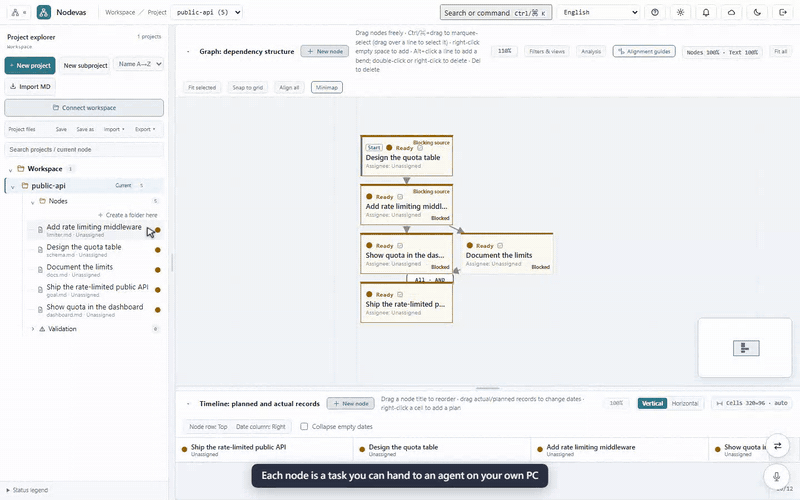
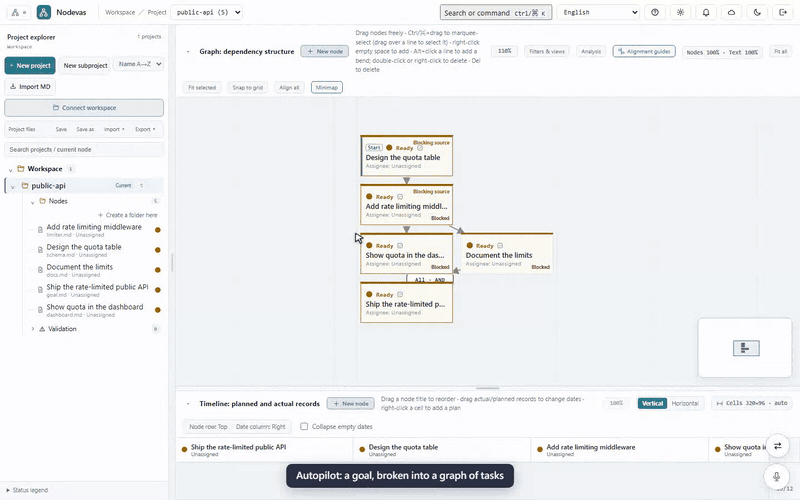

# Agent 工作站

English: [workstation.md](./workstation.md)

server（**hub**）負責顯示看板、run 與改動，但從不啟動任何程式。你電腦上的 **runner**（`nodevas runner`）主動連到 hub，接下你同意的 run，用你自己的登入執行 agent CLI。程式碼、agent 登入與 `gh` 登入都只留在 runner 上。

- **Run**：分成 headless 與互動兩種。headless 把事件串流到節點上；互動模式把 agent 的 TUI 放進瀏覽器。runner 會 commit、push，再用 `gh` 開 PR，並回報 diff 與 CI 狀態。
- **模型**：每次 run 可以自己選 agent 與模型，也可以交給路由規則與 fallback 鏈決定。遇到 rate limit、額度用完或 CLI 不存在時，就改用鏈上的下一個模型。OpenCode 也可以改走 [Agent Client Protocol](https://agentclientprotocol.com)（`nodevas runner set opencodeProtocol acp`，實驗性，僅限 OpenCode 1.x；OpenCode 2 的 run 會改用 `opencode run`）：每個工具呼叫即時串流，而它要求的任何權限一律拒絕，因為 headless run 沒有人可以核准。
- **審查管線**：實作完成後，可以交給其他 agent 或模型審查、交給人審，或兩者都要。要求修改時會再跑一次 revise run。
- **Agent network**：agent 可以看到還有誰在工作、互相傳訊息，也能透過 hub 問你問題（`ask_user`）。
- **工作站**：每個專案的工作站（頂列的「資訊｜工作站｜設定」切換）把這些都放在同一個畫面：
  - 每個 agent 和它正在做的事；
  - 戰情室；
  - 過去一小時誰做了什麼；
  - 等你處理的事；
  - agent 之間的對話，也可以直接發訊息；
  - 目標的自動推進：在目標節點面板頂端按 **自動推進**，就會在這裡開啟。
  
  agent 提問、用量達上限、每日預算用完時，瀏覽器也會通知你。
- **安全預設**：
  - run 需要你在 runner 的終端機上同意。遠端派工需要 step-up passcode，加上你在 runner 上設定的 auto-accept 白名單。
  - 遠端 merge 預設關閉，要自己打開。
  - 審查與拆解一律唯讀，而且不載入 repo 自帶的 agent 設定。
  - hub 放在 Cloudflare Access 後面，runner 用 service token 連線。
  - 可以用驗證器 App 開啟兩步驟驗證（**設定 → 我的帳號**）。開啟後登入還要輸入 App 的驗證碼，step-up 也改問 App，不再寄 email。

設定只要兩步：

1. 部署 hub：見 [Getting started: Team server](./getting-started.md#team-server)。
2. 在 hub 上打開 **設定 → Runner → 連結新裝置**，複製一次性連結。在你的電腦上執行 [`scripts/install.sh --hub <網址> --link`](./install.md#set-up-a-new-pc-with-a-device-link)，帶入允許 run 使用的 repo，出現提示時貼上連結。連結只能用一次、十分鐘內有效；若管理員存過 hub 的 Access service token，連結也會一併帶上，不必再從 Cloudflare 手動複製。

只在一台電腦上自己用時，一個指令就能同時啟動兩者：`nodevas serve --project ./workspace [--repo ~/code/myapp]`（只要 hub 時加 `--no-runner`）。runner 仍是獨立的程序、用自己的 token 連線，每個 run 仍要你在執行 `serve` 的終端機接受。見 [Hub and runner on one machine](./install.md#hub-and-runner-on-one-machine)。

## 用量上限與交接

headless 實作 run 若因 agent 達到用量上限或 rate limit 而停下，runner 會保留已完成的部分，不會丟掉：

- 它把 worktree 提交到本機分支 `nodevas/handoff/<run id>`，只存在 runner 上，不推送、也不開 PR。
- 它寫一份**交接筆記**：agent 被要求做什麼、最後的訊息、改了哪些檔案、最後一個指令，以及它自己計畫中還沒做完的項目。祕密會被遮蔽，筆記上限 8 KB。
- 這個任務的下一次 run 會從該分支接續，不論是 fallback 鏈上的下一個模型，還是額度重置後的同一個模型。筆記以「資料，而非指令」的形式放進它的 prompt。PR 仍以原本的 base 為目標，審查涵蓋整份 diff。
- 若鏈上沒有 fallback 了，run 會等額度重置。重試時間取自 agent 自己的訊息（「resets 3pm」、「try again in 2 hours」、Retry-After），否則用預設退避（rate limit 5 分鐘、額度 1 小時）。run 上會顯示**等待額度重置 · HH:MM 重試**，並有**立即重試**與**取消**。等待在 hub 重啟後仍然有效。時間到時，run 會像一般 run 一樣派送：仍須 runner 接受，也受每日預算限制。一個任務最多等待三次。Autopilot 會把等待中的任務算成排隊中，而不是失敗。
- runner 只會從自己建立、屬於同一個 repository、且仍停在它記錄的 commit 的交接分支接續。hub 可以指名這樣的分支，但不能指定其他任何 ref。交接分支 30 天後刪除。

登入無法使用的模型或不存在的 CLI，會在 agent 第一輪之前就失敗；這時沒有成果可保留，等待也沒用，所以這類失敗仍和以前一樣只沿著鏈往下換模型。

## 示範影片

由 `web/` 裡的 `npm run demo:videos` 從實際的 app 錄製；影片中的 runner、agent 與 hub 資料是模擬的。點影片可開啟原尺寸 MP4。

### 把節點派給 agent

選 runner、agent 與模型，在 runner 上接受，看 OpenCode 透過 ACP 工作，讀 diff，合併 PR。

### 自動推進

在節點面板按目標的 **自動推進**，就會在工作站開啟。目標拆成任務後，每個任務依序實作、跑 CI、由其他模型審查與修改，最後等你審查。

需求中途可以改。直接跟語音副駕說要怎麼改：它會暫停這個目標的自動推進、把變更記在目標的 **Revisions** 底下，再由一次重新規劃重新評估任務：已完成的保留、過時的略過（保留歷史）、進行中的只標記、需要的新任務會加入。規劃期間按鈕顯示 **修訂中…**。結束後副駕會告訴你保留、修改、略過與新增了哪些，並問要不要恢復推進；你說好之前不會恢復。詳見 [COPILOT.md](../COPILOT.md#revising-a-goal-mid-way-internalcopilotrevisego)。

### 兩步驟驗證與裝置連結

在 **設定 → 我的帳號** 開啟驗證器 App、保存復原碼，再從 **設定 → Runner** 連結一台新電腦：step-up 改問 App，hub 產生一次性連結。

### Token 用量

在 **設定 → 用量** 依日期、agent、模型與 session 看 token 用量與 API 等價成本；每日預算另有一頁。

### Agent network

誰在做什麼、agent 之間的訊息，以及一則等你放行的暫留訊息。

